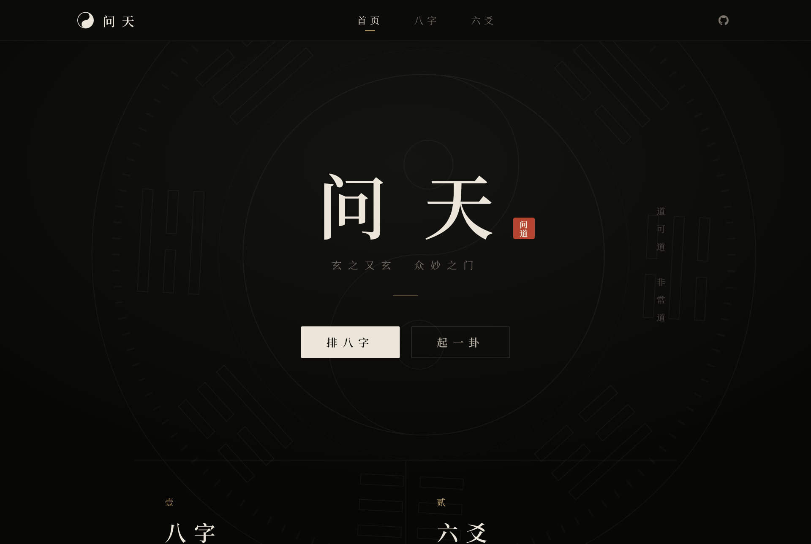
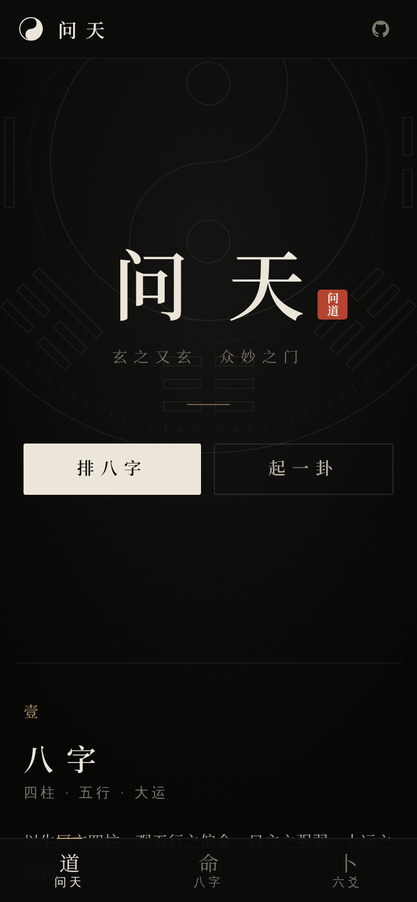
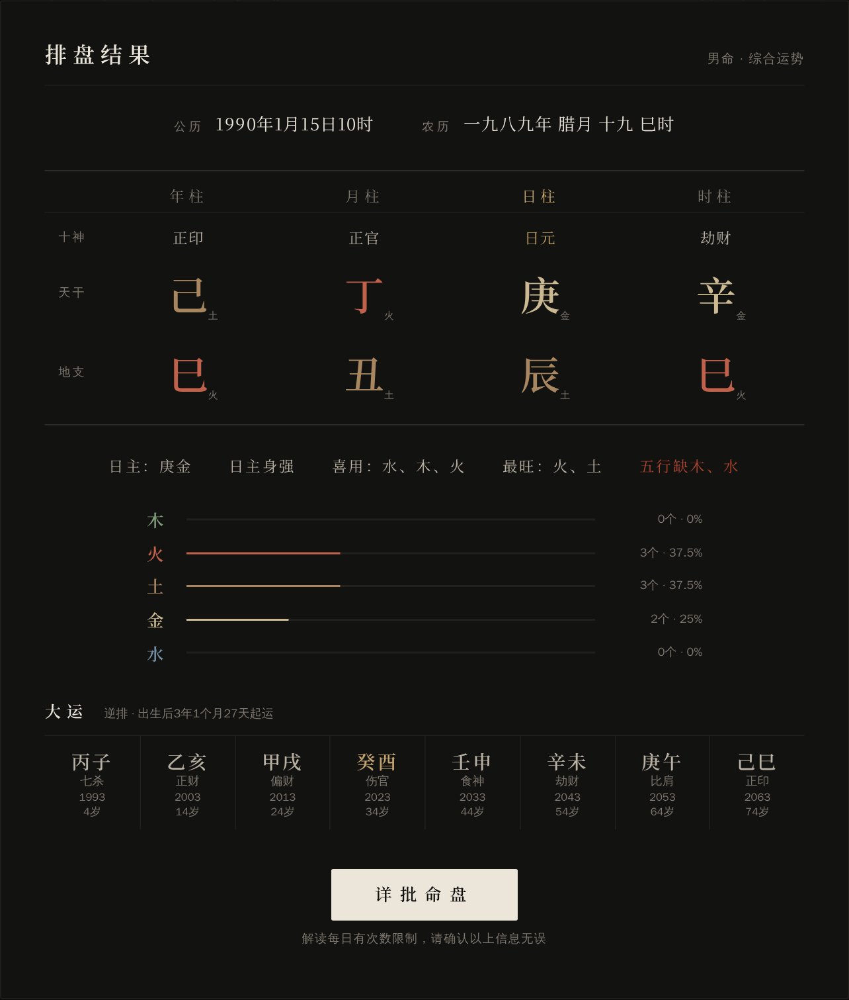
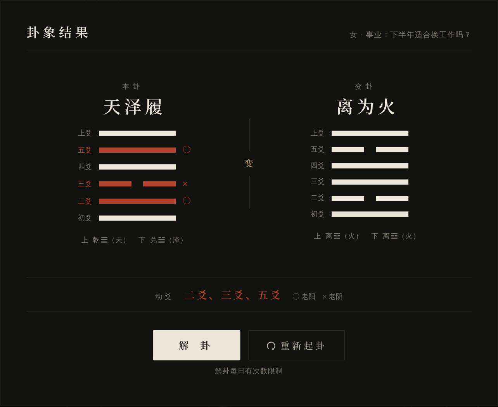

# 问天AI (WenTian AI)

[](https://github.com/timmy1688/wtian/stargazers)
[](https://github.com/timmy1688/wtian/network/members)
[](LICENSE) <!-- 如果有LICENSE文件，请补充，否则删除这行 -->

一个把**传统命理算法**、**典籍原文**与**大语言模型**结合起来的八字排盘与六爻占卜应用。

排盘、起卦、取用全部由程序依古法推算，结果确定可复现；大模型只在这些结果之上，引用《周易》《滴天髓》《穷通宝鉴》《鬼谷子两头钳》原文做解读。

## 🌐 在线体验

[https://wtian.cloud/](https://wtian.cloud/)（兼容手机端）

## 🌟 项目特色

- **代码算、模型讲**：四柱、藏干、十神、旺衰喜用、大运流年、本卦变卦与动爻取用全部由自研算法完成，模型不做任何「心算」
- **引经据典**：内置 64 卦 / 384 爻原文与《滴天髓》《穷通宝鉴》《鬼谷子两头钳》，按命盘与卦象确定性检索，解读只能引用给定原文
- **八字排盘**：公历 / 农历输入，节气精确定月，五行力量量化、日主旺衰、喜用神、合冲刑害、十年大运与流年
- **六爻占卜**：三枚铜钱摇卦，按朱熹《易学启蒙·考变占》定位应占之辞
- **流式解读**：DeepSeek（OpenAI 兼容协议，可替换其他模型）SSE 流式输出，约 1 秒出首字；提示词按「通用 + 领域 + 关注方向」模块组装，配有离线检查与在线评测
- **极简道家风格界面**：玄黑、宋体、留白，桌面与手机端自适应
- **一键部署**：`./wtian.sh deploy` 完成构建、推送镜像、发布前后端、证书续期钩子与健康检查

## 📸 效果展示

<table>
  <tr>
    <td colspan="2" align="center"><b>首页</b><br></td>
    <td rowspan="3" align="center" width="24%"><b>手机端</b><br></td>
  </tr>
  <tr>
    <td align="center" width="38%"><b>八字排盘</b><br></td>
    <td align="center" width="38%"><b>八字解读</b><br></td>
  </tr>
  <tr>
    <td align="center"><b>六爻起卦</b><br></td>
    <td align="center"><b>六爻解读</b><br></td>
  </tr>
</table>

## 🏗️ 软件架构

```
wtian/
├── api/
│   ├── suanfa/   # 算法层：八字排盘、易经起卦与取用（纯计算）
│   ├── dianji/   # 典籍层：《周易》《滴天髓》《穷通宝鉴》《两头钳》原文数据与检索
│   ├── apps/     # 接口层：路由、请求校验、提示词渲染
│   ├── prompts/  # 提示词模块
│   ├── utils/    # 大模型客户端、SSE、限流、日志
│   └── evals/    # 离线检查与在线评测
├── ui/           # Vue3 前端（Vue CLI + Ant Design Vue）
├── docker/       # 生产部署：docker-compose、nginx、证书续期钩子
├── docs/         # 文档（算法说明）
└── wtian.sh      # 统一脚本入口
```

### 推理分工：代码算、模型讲

凡有确定规则的推算全部由程序完成，大模型只在这些结果之上做解读，避免「模型心算」出错：

| 环节 | 由谁完成 | 位置 |
|------|----------|------|
| 四柱干支、节气时刻、农历换算 | lunar_python、lunardate | `api/suanfa/lifa.py` |
| 藏干、十神、十二长生、纳音、旬空、五行力量、日主旺衰、喜用、合冲刑害、大运起运、流年 | 自研算法 | `api/suanfa/` |
| 起卦、本卦/变卦推导、动爻取用（朱熹《易学启蒙·考变占》） | 自研算法 | `api/suanfa/qigua.py`、`quyong.py` |
| 《周易》《滴天髓》《穷通宝鉴》《两头钳》原文，按命盘检索典籍 | 静态数据 + 自研规则 | `api/dianji/` |
| 解读与建议 | DeepSeek | `api/prompts/` |

每个算法的规则、公式与函数位置见 **[docs/算法说明.md](docs/算法说明.md)**。

提示词按「通用规则 + 领域方法 + 关注方向模块」组装（`api/utils/prompting.py`），静态部分在前，可命中 DeepSeek 上下文缓存；
解读接口支持 SSE 流式输出（`/bazi/fenxi/stream`、`/zhanbu/analyze_hexagram/stream`）。

《周易》原文整理自 [open-iching](https://github.com/john-walks-slow/open-iching)，并与 [liuyao-divination](https://github.com/Johnson-Jia/liuyao-divination) 交叉校对。

《滴天髓》（陈素庵辑要本）与《穷通宝鉴》原文取自[维基文库](https://zh.wikisource.org/)（古籍原文属公有领域，录入文本以 CC BY-SA 4.0 授权）。
由 `api/dianji/goujian.py` 繁转简后截取；含寿夭、疾病、克夫克妻、贫贱等宿命断语与科举功名断语的分句一律不收。

《鬼谷子两头钳》（又名《鬼谷子分定经》）以年干、时干取格，排盘页直接展示所得格局与诗句，解读中只作意象参照。正文据 [enter.tw](https://enter.tw/001.htm) 逐格录入本，卦名、星名据 [韩国朗月命理学堂](https://nangwol.com/post/4921) 录入本并互相校对，由 `api/dianji/goujian_liangtouqian.py` 繁转简，宿命断语同样删去；古籍原文属公有领域，录入本版权归原录入者，如有异议请联系删除。
重新生成需安装 `opencc-python-reimplemented`。

技术栈：
- 后端：Python 3.10+、FastAPI、LangChain、Pydantic
- 前端：Vue 3、Vue Router、Ant Design Vue
- 部署：Docker Compose（redis + api + nginx）。页面打进 api 镜像，nginx 只负责证书和反代
- LLM：DeepSeek（deepseek-v4-flash，通过 DEEPSEEK_API_KEY 配置，兼容任意 OpenAI 协议模型）

## 🚀 安装教程

所有常用操作都通过根目录的 `wtian.sh` 完成，`./wtian.sh help` 查看全部命令。

### 方式一：服务器部署

服务器目录结构（部署目录默认为 `~`）：

```
~/docker-compose.yml        # 来自 docker/docker-compose.yml，由 deploy 自动上传
~/.env                      # 密钥与镜像版本（chmod 600），参考 docker/.env.example
~/nginx/conf/nginx.conf     # 来自 docker/nginx/conf/nginx.conf，由 deploy 自动上传
~/nginx/dist/               # 只作 certbot webroot，页面在 api 镜像里
~/nginx/conf/ops-allow.conf # 允许打开 /ops 的地址，每行一条 allow；没有 allow 时公网打不开
~/redis/conf/redis.conf     # requirepass 与 .env 中 RD_PASSWORD 一致
```

首次准备：

1. 服务器安装 Docker（含 compose 插件）与 certbot，签发证书：
   `sudo certbot certonly --webroot -w ~/nginx/dist -d wtian.cloud -d www.wtian.cloud`
2. 在服务器部署目录创建 `.env`（参考 `docker/.env.example`）
3. 本地 `cp .deploy.env.example .deploy.env`，填写服务器地址与 SSH 端口

发布：

```bash
./wtian.sh deploy            # 构建前端并打进镜像 → 发布镜像 → 更新 compose / nginx → 检查状态
./wtian.sh deploy-api TAG    # 只切换镜像版本（同时更新 compose / nginx 配置）
./wtian.sh status            # 容器状态、证书到期时间、接口连通性
```

`deploy` 会安装 certbot 续期钩子 `/etc/letsencrypt/renewal-hooks/deploy/reload-wtian-nginx.sh`，
证书自动续期后重载 nginx（nginx 只在启动或重载时读取证书）。

`/ops` 不在导航里。公网默认打不开，在服务器 `~/nginx/conf/ops-allow.conf` 加上 `allow 你的IP;` 后执行
`sudo docker exec wtian-nginx nginx -s reload`。

回滚：把服务器 `.env` 中的 `API_TAG` 改回旧版本，并把 `docker-compose.yml.bak*`、`nginx/conf/nginx.conf.bak*` 拷回去，
再执行 `sudo docker compose up -d`。只换镜像、不换 nginx 配置时，旧镜像不提供页面，站点会打不开。

### 方式二：本地开发运行

```bash
cd api && pip install -r requirements.txt && cd ..
cp api/.env.example api/.env   # 填写 DEEPSEEK_API_KEY
./wtian.sh dev-api             # 后端 http://127.0.0.1:8000（热重载，需要本机 Redis，默认端口 16666）
./wtian.sh dev-ui              # 前端开发服务器，/api 代理到后端
```

### 测试

```bash
./wtian.sh check           # 离线：排盘算法与 lunar_python 对照、经文与典籍数据、取用规则、提示词组装
./wtian.sh eval --judge    # 在线：固定案例调用真实模型，规则检查 + 模型评审，报告见 api/evals/output/
```

## 📖 使用说明

**八字**：选择公历或农历、性别、出生日期与时辰、关注方向 → 「开始排盘」查看四柱、五行、大运 → 「详批命盘」获取解读。

**六爻**：选择性别与占卜事项，可填写具体问题 → 「诚心起卦」得到本卦、变卦与动爻 → 「解卦」获取解读。

解读每个 IP 每日有次数限制（`ACCESS_LIMIT_PER_DAY`），内容仅供娱乐参考。

## 🤝 参与贡献

1. Fork 本仓库
2. 创建你的特性分支 (`git checkout -b feat/xxx`)
3. 提交你的改动 (`git commit -m 'feat: 添加 xxx 功能'`)
4. Push 到分支 (`git push origin feat/xxx`)
5. 打开 Pull Request

欢迎提交 Issue 或 PR，一起把周易与AI结合得更完美！

## 📄 许可证

[MIT License](LICENSE) （如无LICENSE文件，可自行选择开源协议）

---

**问天AI** —— 让千年智慧遇见现代AI，古为今用，问道未来。

如果觉得项目不错，欢迎点个 Star ✨ 支持一下！

