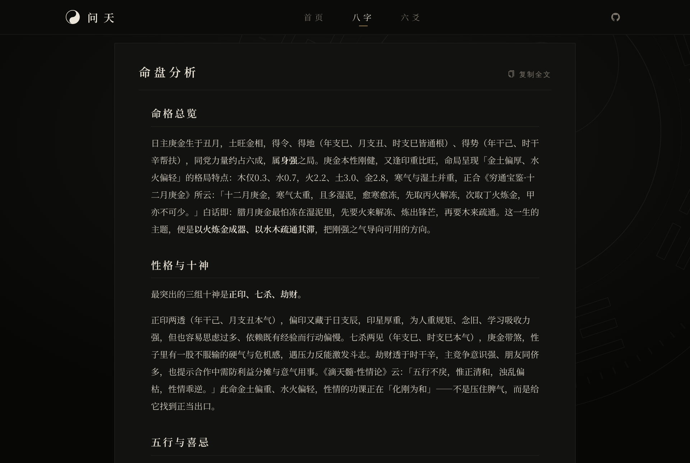
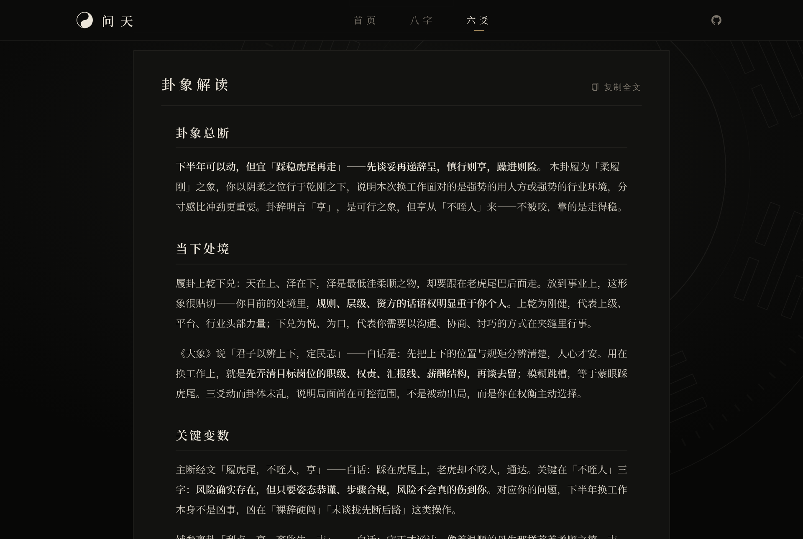

# 问天AI (WenTian AI)

[](https://github.com/timmy1688/wtian/stargazers)
[](https://github.com/timmy1688/wtian/network/members)
[](LICENSE) <!-- 如果有LICENSE文件，请补充，否则删除这行 -->

一个将**大语言模型 (LLM)** 与**中国传统文化《周易》（I Ching）** 深度结合的AI问卦/解卦应用。

通过自然语言与AI对话，你可以像古代贤者一样"问天"——求卦、解卦、预测运势、人生建议，甚至结合现代事件进行周易解读。

## 🌐 在线体验

立即体验问天AI：[https://wtian.cloud/](https://wtian.cloud/)

## 🌟 项目特色

- **传统算法与现代AI融合**：核心测算公式经过多部经典易经书籍总结提炼，保证算法的古典韵味与精准度
- **大模型深度分析**：利用大语言模型进行智能解卦，默认接入 DeepSeek（OpenAI 兼容协议，可替换为其他 LLM），提供专业而富有洞见的解读
- **LangChain框架集成**：应用LangChain框架优化提示词工程，提升AI问卦的准确性和表达质量
- **多样化起卦方式**：支持手动输入、随机摇卦、报数起卦、时间起卦等多种传统起卦方法
- **完整的前后端分离架构**：前端 Vue3 + Element Plus，后端 FastAPI + LangChain
- **Docker一键部署**：轻松本地运行或云部署，支持多模型切换、历史记录、卦象可视化

## 📸 效果展示

### 首页


### 八字排盘


### 八字分析


### 八卦起卦


### 八卦分析


## 🏗️ 软件架构

```
wtian/
├── api/
│   ├── suanfa/   # 算法层：八字排盘、易经起卦与取用（纯计算）
│   ├── dianji/   # 典籍层：《周易》《滴天髓》《穷通宝鉴》原文数据与检索
│   ├── apps/     # 接口层：路由、请求校验、提示词渲染
│   ├── prompts/  # 提示词模块
│   ├── utils/    # 大模型客户端、SSE、限流、日志
│   └── evals/    # 离线检查与在线评测
├── ui/           # Vue3 前端（Vue CLI + Element Plus）
├── docker/       # Docker Compose 配置
├── docs/         # 文档（算法说明）
└── wtian.sh      # 统一脚本入口
```

### 推理分工：代码算、模型讲

凡有确定规则的推算全部由程序完成，大模型只在这些结果之上做解读，避免「模型心算」出错：

| 环节 | 由谁完成 | 位置 |
|------|----------|------|
| 四柱干支、节气时刻、农历换算 | lunar_python、lunardate | `api/suanfa/lifa.py` |
| 藏干、十神、十二长生、纳音、旬空、五行力量、日主旺衰、喜用、合冲刑害、大运起运、流年 | 自研算法 | `api/suanfa/` |
| 起卦、本卦/变卦推导、动爻取用（朱熹《易学启蒙·考变占》） | 自研算法 | `api/suanfa/qigua.py`、`quyong.py` |
| 《周易》《滴天髓》《穷通宝鉴》原文，按命盘检索典籍 | 静态数据 + 自研规则 | `api/dianji/` |
| 解读与建议 | DeepSeek | `api/prompts/` |

每个算法的规则、公式与函数位置见 **[docs/算法说明.md](docs/算法说明.md)**。

提示词按「通用规则 + 领域方法 + 关注方向模块」组装（`api/utils/prompting.py`），静态部分在前，可命中 DeepSeek 上下文缓存；
解读接口支持 SSE 流式输出（`/bazi/fenxi/stream`、`/zhanbu/analyze_hexagram/stream`）。

《周易》原文整理自 [open-iching](https://github.com/john-walks-slow/open-iching)，并与 [liuyao-divination](https://github.com/Johnson-Jia/liuyao-divination) 交叉校对。

《滴天髓》（陈素庵辑要本）与《穷通宝鉴》原文取自[维基文库](https://zh.wikisource.org/)（古籍原文属公有领域，录入文本以 CC BY-SA 4.0 授权）。
由 `api/dianji/goujian.py` 繁转简后截取；含寿夭、疾病、克夫克妻、贫贱等宿命断语与科举功名断语的分句一律不收。
重新生成需安装 `opencc-python-reimplemented`。

技术栈：
- 后端：Python 3.10+、FastAPI、LangChain、Pydantic
- 前端：Vue 3、Pinia、Vue Router、Element Plus
- 部署：Docker + Docker Compose
- LLM：DeepSeek（deepseek-v4-flash，通过 DEEPSEEK_API_KEY 配置，兼容任意 OpenAI 协议模型）

## 🚀 安装教程

所有常用操作都通过根目录的 `wtian.sh` 完成，`./wtian.sh help` 查看全部命令。

### 方式一：Docker 部署

```bash
git clone https://github.com/timmy1688/wtian.git
cd wtian

# docker-compose 从 docker/.env 读取 DEEPSEEK_API_KEY
echo "DEEPSEEK_API_KEY=sk-..." > docker/.env

./wtian.sh build-api      # 构建并推送后端镜像（tag 默认当天日期，镜像名可用 IMAGE 覆盖）
./wtian.sh build-ui       # 构建前端到 ui/dist，放到 docker/nginx/dist 由 nginx 托管
./wtian.sh restart        # 在 docker/ 下重启全部容器
```

部署前端到远程服务器：`DEPLOY_HOST=user@host DEPLOY_PORT=22 ./wtian.sh deploy-ui`。

### 方式二：本地开发运行

```bash
cd api && pip install -r requirements.txt && cd ..
cp api/.env.example api/.env   # 填写 DEEPSEEK_API_KEY
./wtian.sh dev-api             # 后端 http://127.0.0.1:8000（热重载，需要本机 Redis，默认端口 16666）
./wtian.sh dev-ui              # 前端开发服务器，/api 代理到后端
```

### 测试

```bash
./wtian.sh check           # 离线：排盘算法与 lunar_python 对照、经文与典籍数据、取用规则、提示词组装
./wtian.sh eval --judge    # 在线：固定案例调用真实模型，规则检查 + 模型评审，报告见 api/evals/output/
```

## 📖 使用说明

1. 打开网页，进入“问天”页面
2. 输入你的问题（如“明年事业运势如何？”）
3. 选择起卦方式（默认AI智能起卦）
4. AI 将自动为你起卦、变卦、解卦，并结合大模型给出深度解读
5. 支持导出卦象、保存历史记录

## 🤝 参与贡献

1. Fork 本仓库
2. 创建你的特性分支 (`git checkout -b feat/xxx`)
3. 提交你的改动 (`git commit -m 'feat: 添加 xxx 功能'`)
4. Push 到分支 (`git push origin feat/xxx`)
5. 打开 Pull Request

欢迎提交 Issue 或 PR，一起把周易与AI结合得更完美！

## 📄 许可证

[MIT License](LICENSE) （如无LICENSE文件，可自行选择开源协议）

---

**问天AI** —— 让千年智慧遇见现代AI，古为今用，问道未来。

如果觉得项目不错，欢迎点个 Star ✨ 支持一下！

